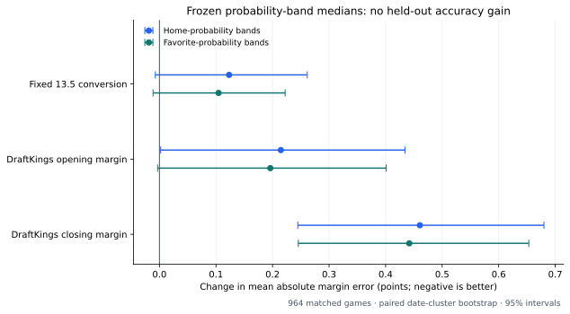

# Frozen median-margin benchmark: 2025–26

**The probability-band median forecasts did not improve margin prediction accuracy on this
holdout.** DraftKings' closing margin forecast had the lowest mean absolute error, followed
by its opening forecast and the fixed 13.5 conversion. Both band-median versions had higher
point-estimate errors. This is a forecast benchmark, not a test of a wagering selection rule.

## Design

Train frozen 10-percentage-point lookup medians using **8,438 out-of-sample probability/outcome
pairs from seasons before 2025–26**. Evaluate on **964 identical 2025–26 games** with complete
DraftKings opening and closing lines and final scores, November 25, 2025 through April 12, 2026.
Neither the target season's scores nor its probabilities enter the lookup fit.

Two candidates retain the distinction in the earlier tables:

- Home-band median: each home-win-probability band predicts its earlier-season median home margin.
- Favorite-band median: each favorite-win-probability band predicts its earlier-season median
  favorite margin, then converts the result to a signed home margin.

Market forecasts use minus the quoted home handicap. All outcomes are final home-minus-away
scores, including overtime. MAE is the primary median-forecast metric; RMSE is secondary.

## Results

| Forecast | Games | MAE, points | RMSE, points | Mean home-margin bias |
|---|---:|---:|---:|---:|
| DraftKings closing | 964 | **11.0560** | **14.1410** | +0.3205 |
| DraftKings opening | 964 | 11.3019 | 14.4319 | +0.2842 |
| Fixed 13.5 conversion | 964 | 11.3934 | 14.5812 | +0.4304 |
| Favorite-band median | 964 | 11.4979 | 14.6895 | +0.0228 |
| Home-band median | 964 | 11.5166 | 14.7134 | -0.0934 |



The home-band candidate's MAE exceeds the closing forecast by **0.4606 points**, with a paired
date-cluster bootstrap 95% interval of **[+0.2447, +0.6801]**. The favorite-band candidate exceeds
it by **0.4419 points**, interval **[+0.2456, +0.6532]**. Both reported intervals favor the closing
forecast on this sample.

Against fixed 13.5, the differences are smaller and uncertain: **+0.1232** for home bands
**[-0.0073, +0.2614]**, and **+0.1045** for favorite bands **[-0.0113, +0.2223]**. Thus this
experiment provides no evidence that the coarse median lookups improve on fixed 13.5.

Against the opening forecast, MAE differences are **+0.2147** for home bands
**[+0.0021, +0.4343]**, and **+0.1961** for favorite bands **[-0.0032, +0.4009]**. The home-band
interval only narrowly excludes zero, and none of these intervals is adjusted for multiple
comparisons. Do not overinterpret that borderline result.

## Median calibration is not the same as accuracy

Both median candidates have zero median forecast error and a low observed average bias. For
the home-band forecast, 46.89% of final margins fall strictly below the forecast and 50.31%
fall at or below it. The favorite-band values are 47.61% and 50.62%. The interval around exact
ties contains 50% for both, which is compatible with marginal median calibration.

That aggregate midpoint behavior does not make the individual predictions more accurate:
both still have higher MAE. Group-level cancellation can conceal conditional errors. For
example, on the 23 held-out games in the 90–100% home-WP band, the frozen home-band forecast
is +13.5 while the observed median is +19. That is a small descriptive subgroup, not a new
fitted correction. The 0–10% home-WP band has only 16 training games and one holdout game.

## Important limits

- The model forecasts are reconstructed pregame WP, not historical predictions archived at
  each opening line's timestamp. All 964 reconstructed rows have no original snapshot timestamp.
  Opening and closing endpoints therefore represent different information sets, and the
  opening comparison is not a simultaneous-forecast experiment.
- The target-season WP fits and weights use prior seasons, and the median lookup uses only
  prior-season OOS WP/outcomes. However, this season was already visible in earlier model
  development and analysis. Chronological training exclusion does not make this an untouched
  prospective holdout.
- All 964 matched test games use the availability route. The lookup training pool mixes
  older base/fallback routes with more recent availability routes. Era and route differences
  can affect the relationship between WP and margin.
- Ten-point bands are deliberately simple and coarse. A continuous conditional-median model
  or a different training window is a different hypothesis and has not been validated here.
- Date-cluster bootstrap intervals use 2,000 draws, seed 20261021. They keep games on the same
  sampled date together, but do not capture cross-date serial dependence or model-selection risk.

## Files and verification

- [Full generated report](REPORT.md), including frozen lookup values, all uncertainty intervals,
  median calibration, probability-band diagnostics, and source coverage.
- `metrics.csv`, `comparisons.csv`, `frozen_bands.csv`, `holdout_bands.csv`, and `audit.json`.
- [Successful independent benchmark run](https://github.com/Dave356w/nba-matchups/actions/runs/39679730249).
- [Full per-game predictions and report artifact](https://github.com/Dave356w/nba-matchups/actions/runs/39679730249/artifacts/12383541391).
- [PR #77](https://github.com/Dave356w/nba-matchups/pull/77).

Source commit: `8ebe8a2733717edd1e6908fca2f976d243311d8a`.
All 267 tests and data validation passed locally. The independent benchmark workflow passed
and its metrics and uncertainty intervals match the local results. Exact score joins agree
across sources; the maximum reconstructed-WP difference is 0.00004879, within CSV rounding.
No production models, display math, or ledgers were changed.

To reproduce from the versioned inputs, without a historical data download:

```bash
python research/median_margin_benchmark.py --out /tmp/median-margin-benchmark
```
