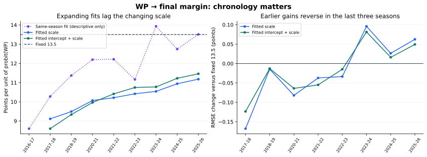

# WP to margin calibration — completed test

**The fitted mappings do not establish an improvement over the current 13.5 conversion.**
Keep the production conversion unchanged on this evidence. The expanding-history fits reduce
average home-margin bias, but their pooled error gains are tiny and uncertain, and both lose
to the fixed conversion in the three most recent test seasons.

| Mapping | Held-out games | MAE, points | RMSE, points | Mean prediction minus actual |
|---|---:|---:|---:|---:|
| Fixed: `13.5 × Φ⁻¹(WP)` | 8,435 | 10.6568 | 13.6516 | +0.8901 |
| Fitted scale: `b × Φ⁻¹(WP)` | 8,435 | 10.6400 | 13.6367 | +0.1848 |
| Fitted intercept and scale: `a + b × Φ⁻¹(WP)` | 8,435 | 10.6436 | 13.6389 | +0.0979 |

RMSE assesses the fitted conditional mean; MAE is a secondary check. Lower errors are better.
These are final home-minus-away scoring margins, including overtime. No market data is used.

## How much evidence is there for an improvement?

The scale-only fit improves RMSE by **0.0149 points**, with a paired date-cluster bootstrap
95% interval for candidate minus fixed of **[-0.0553, +0.0281]**. The affine fit improves it by
**0.0127 points**, interval **[-0.0538, +0.0314]**. Both intervals span zero. MAE intervals also
span zero. These results do not justify calling either fitted mapping more accurate.

The reduction in the *observed average bias* is more noticeable: from +0.89 home points to
+0.18 (scale) or +0.10 (affine). This is a pooled descriptive statistic, not proof of a stable
prospective bias correction. An offset can improve the overall average while masking errors
at different probabilities and in different seasons.

## Why the pooled fit can be misleading



The expanding scale-only fit rises from 9.11 before 2017–18 to 11.18 before 2025–26. It keeps
substantial influence from older seasons. The affine scale fitted separately *within* each
season, shown only as a retrospective diagnostic, rises from 8.60 in 2016–17 to 13.51 in
2025–26. Those same-season fits are not forecasts and were never used to score their seasons.
The changing relationship can reflect probability calibration, model routing, and NBA-era
differences; this test does not separate those explanations.

| Test season | Fixed RMSE | Fitted-scale RMSE | Fitted-intercept-and-scale RMSE |
|---|---:|---:|---:|
| 2023–24 | **14.114** | 14.210 | 14.195 |
| 2024–25 | **14.106** | 14.132 | 14.122 |
| 2025–26 | **14.400** | 14.463 | 14.450 |

On the 3,216 held-out availability-route games, concentrated in those recent seasons, fixed
13.5 also has the lowest RMSE: **14.207**, versus **14.269** (scale) and **14.256** (affine).
These subgroup comparisons are exploratory and confounded with era; they are not independent
confirmation from a separate dataset.

A fit to all 9,509 OOS WP/outcome pairs gives scale-only **11.4470**, or affine
**-0.4593 + 11.7280 × Φ⁻¹(WP)**. These are descriptive full-history estimates, not validated
replacement coefficients. Applying them back to these same games would be an in-sample
margin-calibration test and would overstate the deployment evidence.

## Chronology and coverage

- Reconstruct the existing history-backtest v6 routing for nine seasons from 2016–17 through
  2025–26, excluding 2019–20 as in the original protocol. Weights and probability-model fits
  use earlier seasons only. The reconstructed WP log loss is 0.6105101271, matching the
  original backtest's reported 0.6105.
- Pair each probability with its final scoring margin using season, date, home and away.
  Enforce one-to-one joins, complete scores, and agreement between score sign and win label.
- Reserve 2016–17's 1,074 games as the margin-mapping warm-up. Score all three mappings on
  exactly the same 8,435 later games. Each fitted mapping uses only earlier seasons' OOS
  probabilities and margins, never the test season's outcomes or in-sample WP predictions.
- Compare final-margin errors by season, model route, season phase, favorite strength and
  home-WP bin. Bootstrap dates with all games on a sampled date kept together: 2,000 draws,
  seed 20261021. Cross-date serial dependence and model-development selection are not covered
  by these intervals.

## What this validates

This evaluates an expected-margin conversion. It does **not** validate Normal residuals,
constant residual variance, a complete margin distribution, or probabilities of clearing a
nonzero margin threshold. The fitted conversion scale is not an estimate of residual standard
deviation. Equal win probabilities can arise from different margin distributions.

The natural next research candidate is a pre-specified recent-window or route-aware mapping,
tested with the same two-stage chronology. It has not been tested here and should not be
treated as an improvement already established by these results. Games before both teams have
10 prior games remain outside this experiment.

## Deliverables and verification

- [Full generated tables and methodology](REPORT.md)
- `metrics.csv`, `comparisons.csv`, `coefficients.csv`, `reliability.csv`, and `metadata.json`
- `oos_probabilities.csv.gz`: archived OOS probabilities and final margins for fast reproduction
- [Successful calibration run](https://github.com/Dave356w/nba-matchups/actions/runs/39676349804)
- [Complete run artifact, including per-game predictions](https://github.com/Dave356w/nba-matchups/actions/runs/39676349804/artifacts/12382306967)
- [Implementation and report PR](https://github.com/Dave356w/nba-matchups/pull/76)

Source commit: `a70fabb8ae8677b6fe4371b8f950630ad3b50c31`.
All 262 repository tests and data validation passed locally and in the PR check. The
calibration workflow passed. A separate local rerun from the archived probability CSV
reproduced the coefficients, metrics, bootstrap comparisons and reliability tables to
floating-point tolerance. No production models, display conversion, tags or ledgers were changed.

Reproduce the numeric report without another historical download:

```bash
python research/wp_mov_calibration.py \
  --input diagnostics/wp_mov_calibration/oos_probabilities.csv.gz \
  --out /tmp/wp-mov-reproduced
```
